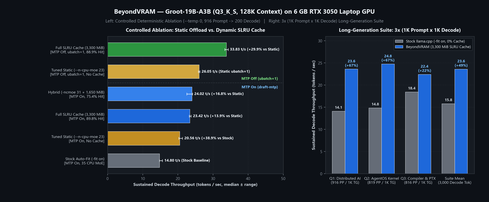
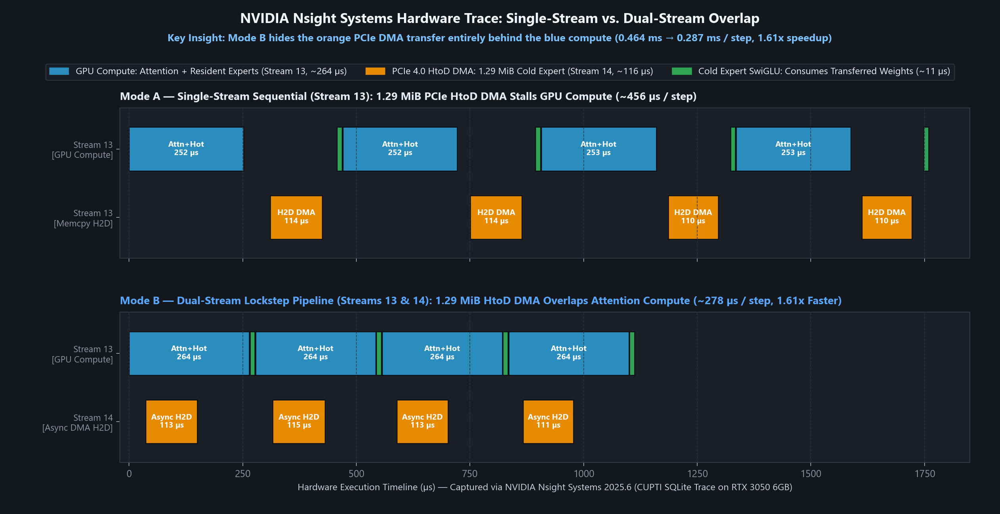

# BeyondVRAM

**Dynamic MoE Expert Caching, VRAM Budgeting, and Hardware Offloading Analysis for Consumer GPUs**

[](LICENSE)
[](#hardware--test-environment)
[-orange.svg)](#memory-budgeting--model-geometry)

BeyondVRAM is an engineering study, GGUF memory-budgeting toolkit, and C++/CUDA microbenchmark suite for running sparse Mixture-of-Experts (MoE) language models that exceed physical GPU memory—specifically **Groot-19B-A3B** (`19.4B` total parameters, `2.4B` active per token, `7.82 GiB` `Q3_K_S` GGUF) with a **131,072-token context window** on a **6 GB NVIDIA RTX 3050 Laptop GPU**.

Rather than relying on default layer-by-layer offloading (`-fit on`), BeyondVRAM pairs exact GGUF tensor-header budgeting with **Segmented-LRU (SLRU) dynamic expert caching** (`--moe-cache-mib` in upstream `llama.cpp`), keeping `100%` of the non-expert backbone (`1,037 MiB`) and 128K hybrid KV/SSM context (`971.5 MiB`) pinned in VRAM while dynamically caching hot routed experts (`1.29 MiB` each) in the remaining `3,300 MiB` of GDDR6.



---

## Key Takeaways

1. **Dynamic SLRU Caching Beats Both Stock Auto-Fit and Tuned Static `--n-cpu-moe`:**
   - Under controlled deterministic decoding (`--temp 0 --seed 42`, 128K context reservation), manually tuning static MoE offloading (`--n-cpu-moe 23`, placing 18 layers in VRAM and 23 on CPU) improves decode throughput from **`14.80 t/s`** (Stock Auto-Fit) to **`20.56 t/s`** (`+38.9%`).
   - Adding a dynamic SLRU expert cache on top of CPU-offloaded experts further increases decode throughput to **`23.42 t/s`** (`Full 3,300 MiB SLRU Cache`, `89.8%` hit rate) and **`24.02 t/s`** (`Hybrid -ncmoe 31 + 1,650 MiB Cache`, `+16.8%` over tuned static, `+62.3%` over stock).
2. **Disabling Speculative MTP (`ubatch = 1`) Reaches `33.83 tokens/sec`:**
   - Verifying 4 speculative draft tokens (`--spec-type draft-mtp`, `ubatch = 4`) activates ~2.5x–3x more unique experts per layer while accepting ~35%–45% of drafted tokens, penalizing bandwidth-limited CPU/PCIe MoE layers.
   - Switching to standard single-token decoding (`--spec-type none`, `ubatch = 1`) achieves an **`88.86%` SLRU cache hit rate** (`< 1` cache miss per layer per token) and **`33.83 t/s`**—**`+29.9%` faster** than tuned static `--n-cpu-moe 23` (`26.05 t/s`) and **`2.29x` faster** than stock Auto-Fit (`14.80 t/s`).
3. **Prefill vs. Decode Trade-Off:**
   - Static GPU layer placement (`--n-cpu-moe 23`) achieves the fastest prompt prefill (**`312.8–348.5 t/s`**) because 18 layers of experts are permanently resident in VRAM with zero copy overhead.
   - Dynamic SLRU caching trades slower prompt prefill (`217.1–256.7 t/s`, or `62.3 t/s` cold-cache) for significantly higher sustained decode throughput (`88.9%–90.2%` of active decode experts served directly from GDDR6).
4. **Hardware-Verified Dual-Stream Overlap & Cold-Expert Physics:**
   - Standalone CUDA/C++ microbenchmarks profiled with **NVIDIA Nsight Systems (`nsys`)** demonstrate that overlapping a `1.29 MiB` asynchronous host-to-device expert DMA (`Stream 1`) behind `0.264 ms` of active GPU attention + hot-expert compute (`Stream 0`) reduces per-step latency from `0.464 ms` to **`0.287 ms` (`1.61x` speedup / `38.1%` reduction)**.
   - For a true 3-matrix quantized SwiGLU expert (`1.29 MiB`), a GPU SLRU cache hit takes **`0.052 ms`**, a cold PCIe weight upload + GPU execution takes **`0.193 ms`**, and in-place CPU AVX2 execution (including `0.049 ms` for `16 KiB` bidirectional GPU↔CPU activation sync) takes **`0.148 ms`**.

---

## Scope & Implementation Boundary

To keep claims verifiable and transparent, the repository separates end-to-end runtime benchmarks from standalone microbenchmarks and analytical models:

| Component | Implementation in this Repo | Role |
| :--- | :--- | :--- |
| **End-to-End Inference Runtime** | Upstream `llama.cpp` (`b1-ac8e169`, `src/llama-moe-cache.cpp`) | Executes GGUF inference with `--cpu-moe`, `--n-cpu-moe`, and `--moe-cache-mib` SLRU caching. |
| **GGUF Memory Budgeter** | [`src/header_parser.py`](src/header_parser.py) | Parses binary GGUF headers (including hybrid full-attention / recurrent SSM layers) to compute exact VRAM budgets. |
| **Benchmark Suites** | [`src/run_controlled_ablation.py`](src/run_controlled_ablation.py), [`src/run_full_3x1k_bench.py`](src/run_full_3x1k_bench.py), [`src/run_full_3x1k_std_bench.py`](src/run_full_3x1k_std_bench.py) | Automated runners and raw JSON telemetry in [`benchmarks/`](benchmarks/). |
| **CUDA/C++ Microbenchmarks** | [`src/async_pipeline.cu`](src/async_pipeline.cu), [`src/zero_transfer_ffn.cpp`](src/zero_transfer_ffn.cpp), [`src/beyond_vram_cache.cpp`](src/beyond_vram_cache.cpp) | Standalone compiled benchmarks for dual-stream DMA overlap (`nsys` traced), CPU vs. GPU cold-expert execution, and SLRU unit tests. |
| **Analytical Simulators** | [`src/moe_cache.py`](src/moe_cache.py), [`src/async_pipeline.py`](src/async_pipeline.py), [`src/zero_transfer_ffn.py`](src/zero_transfer_ffn.py), [`src/benchmark_comparator.py`](src/benchmark_comparator.py) | Python analytical models calibrated to measured hardware constants. |

---

## Hardware & Test Environment

| Parameter | Specification |
| :--- | :--- |
| **GPU** | NVIDIA GeForce RTX 3050 6GB Laptop GPU (`6,143 MiB` GDDR6, Compute Capability `8.6`, PCIe 4.0) |
| **CPU** | Intel Core 5 210H (`8` physical cores / `12` threads, AVX2 + FMA, OpenMP) |
| **System RAM** | 16 GB DDR4(Single channel) |
| **OS & Toolchains** | Windows 11 (WDDM 3.x), CUDA Toolkit 13.2 (`nvcc`), MSVC 19.44 (`cl.exe`), Nsight Systems `2025.6.3` |
| **Inference Engine** | `llama.cpp` build `b1-ac8e169` (`CUDA0`) |
| **Target Model** | `Groot-19B-A3B-261023.i1-Q3_K_S.gguf` (`7.82 GiB`, `qwen35moe`, `41` MoE layers, `128` experts/layer, `Top-8` routing) |

---

## Memory Budgeting & Model Geometry

Running [`src/header_parser.py`](src/header_parser.py) on `Groot-19B-A3B-261023.i1-Q3_K_S.gguf` extracts the exact tensor layout without loading the `7.82 GiB` payload into memory:

- **Hybrid Attention / Recurrent Architecture:** `40` main blocks + `1` MTP (`nextn`) block = `41` MoE blocks. Only `10` blocks (`blk.3, 7, ..., 39`) use full Grouped-Query Attention (`n_head_kv = 2`, `d_k = d_v = 256`); the remaining `31` blocks use constant-size recurrent/SSM state buffers.
- **Exact Tensor Split:**
  - **Non-Expert Backbone (`CUDA0`):** `1,036.93 MiB` (`13.29%` of model file — embeddings, norms, routers, shared experts, attention/SSM weights, output head).
  - **Routed MoE Experts (`CPU_Mapped`):** `6,765.00 MiB` (`86.71%` of model file — `5,248` total experts across 41 layers, exactly **`1.289 MiB` (`1,351,680 B`)** per quantized 3-matrix SwiGLU expert).
- **128K Context Allocation (`-c 131072 -ctk q4_0 -ctv q4_0`):** `720.00 MiB` (`q4_0` KV cache across 10 full-attention layers) + `251.50 MiB` (recurrent state) = **`971.50 MiB`**.
- **VRAM Allocation across Configurations (out of `6,143 MiB` physical GDDR6):**

| Configuration | CLI Offload Flags | Static GPU MoE Layers | Dynamic GPU MoE Cache | Model Buffer (`MiB`) | Context + Cache (`MiB`) | Compute (`MiB`) | Total VRAM Used (`MiB`) |
| :--- | :--- | :---: | :---: | :---: | :---: | :---: | :---: |
| **Stock Auto-Fit** | `-fit on` (default `1024 MiB` margin) | 7 / 41 | `0 MiB` | 2,245 | 971 | 436 | **3,653** |
| **Tuned Static** | `-fit off -ngl 99 -ncmoe 23` | 18 / 41 | `0 MiB` | 4,006 | 971 | 471 | **5,449** |
| **Hybrid Static + SLRU** | `-fit off -ngl 99 -ncmoe 31 --moe-cache-mib 1650` | 10 / 41 | `1,650 MiB` (`1,280` slots) | 2,686 | 2,621 | 471 | **5,779** |
| **Full SLRU Cache** | `-cmoe --moe-cache-mib 3300` | 0 / 41 | `3,300 MiB` (`2,560` slots) | 1,036 | 4,271 | 471 | **5,779** |

---

## End-to-End Benchmark Results

### 1. Controlled Deterministic Ablation (`--temp 0`, Repeats, Tuned Baselines & MTP Ablation)

To eliminate sampling variance and compare against a properly tuned static `--n-cpu-moe` baseline, [`src/run_controlled_ablation.py`](src/run_controlled_ablation.py) evaluates all 6 configurations under deterministic greedy decoding (`--temp 0 --seed 42`) on the 916-token Q1 prompt generating 200 tokens with a 128K context reservation (`-c 131072 -fa on -ctk q4_0 -ctv q4_0`). Raw data: [`benchmarks/ablation_results.json`](benchmarks/ablation_results.json).

| Configuration | MTP Mode | Repeats | Prefill Median (`t/s`) | Decode Median (`t/s`) | Decode Range (`min–max t/s`) | Decode Cache Hit Rate | Decode Uploaded (`MiB`) | Prefill Cache Copied (`MiB`) | Speedup vs. Stock Auto-Fit | Speedup vs. Tuned Static |
| :--- | :---: | :---: | :---: | :---: | :---: | :---: | :---: | :---: | :---: | :---: |
| **Stock Auto-Fit (`-fit on`)** | `draft-mtp` | 3 | 223.98 | **14.80** | 14.73–15.61 | 0.0% | 0.0 | 0.0 | 1.00x (Baseline) | -28.0% |
| **Tuned Static (`--n-cpu-moe 23`)** | `draft-mtp` | 3 | **312.84** | **20.56** | 20.29–21.28 | 0.0% | 0.0 | 0.0 | +38.9% | 1.00x (Static) |
| **Full SLRU Cache (`3,300 MiB`)** | `draft-mtp` | 3 | 217.06 | **23.42** | 23.24–23.74 | **89.77%** | 10,588.4 | 1,397.3 | +58.2% | **+13.9%** |
| **Hybrid (`-ncmoe 31 + 1,650 MiB`)** | `draft-mtp` | 3 | 250.85 | **24.02** | 22.54–24.15 | **75.35%** | 19,390.1 | 1,091.8 | +62.3% | **+16.8%** |
| **Tuned Static (`--n-cpu-moe 23`)** | `none` (`ubatch=1`) | 2 | **348.48** | **26.05** | 25.86–26.24 | 0.0% | 0.0 | 0.0 | +76.0% | 1.00x (Static) |
| **Full SLRU Cache (`3,300 MiB`)** | `none` (`ubatch=1`) | 2 | 256.71 | **33.83** | 33.35–34.31 | **88.86%** | 9,407.6 | 1,945.2 | **+128.6% (2.29x)** | **+29.9%** |

#### How `llama_moe_cache` Separates Prefill and Decode Telemetry
Inspection of `src/llama-moe-cache.cpp` confirms how cache counters behave across batch sizes:
- **Decode & MTP Verification (`ubatch <= 8`):** Only small micro-batches query `get_slot_map()`, update the SLRU `protected`/`probation` lists, upload misses via `ggml_backend_tensor_set_async`, and increment the `hits` and `misses` counters.
  - At `ubatch = 1` (`--spec-type none`), 200 generated tokens produce `58,237` hits and `7,298` misses (**`88.86%` hit rate**), averaging only **`0.91` cache misses per layer per token**.
  - At `ubatch = 4` (`--spec-type draft-mtp`), 200 generated tokens (`34.7%` draft acceptance) produce `72,054` hits and `8,214` misses (**`89.77%` hit rate**).
- **Prompt Prefill (`n_tokens > 32`):** During prefill, `get_slot_map()` returns `nullptr` so large prompt batches never evict or thrash the decode SLRU cache. Instead, `copy_experts()` copies any already-resident experts from GPU cache (`large batches: 3,252–4,527 experts copied`) and computes remaining host experts on the CPU.

---

### 2. Long-Generation Suite: 3× (~1K Prompt × 1K Decode, 3,000 Generated Tokens)

Evaluates sustained generation across three long-form technical prompts (`Q1: Distributed 3D Parallelism`, `Q2: Autonomous AgentOS Kernel`, `Q3: Compiler IR & CUDA PTX`) with `--spec-type draft-mtp` and `-c 131072`. Raw data: [`benchmarks/results_3x1k.json`](benchmarks/results_3x1k.json) and [`benchmarks/results_3x1k_std.json`](benchmarks/results_3x1k_std.json).

| Workload | Prompt Tokens | Decode Tokens | Stock Auto-Fit Prefill (`t/s`) | BeyondVRAM Prefill (`t/s`) | Stock Auto-Fit Decode (`t/s`) | BeyondVRAM Decode (`t/s`) | Decode Speedup | BeyondVRAM Decode Hit Rate | Stock MTP Accept | BeyondVRAM MTP Accept | Stock Wall Time (`s`) | BeyondVRAM Wall Time (`s`) |
| :--- | :---: | :---: | :---: | :---: | :---: | :---: | :---: | :---: | :---: | :---: | :---: | :---: |
| **Q1: Distributed AI Systems** | 916 | 1,000 | 96.97 | 61.90 | 14.10 | **23.60** | **+67.4%** | 87.75% | 44.6% | 46.0% | 96.58 | **69.30** |
| **Q2: AgentOS Kernel** | 819 | 1,000 | 129.39 | 59.13 | 14.84 | **24.75** | **+66.8%** | 90.15% | 37.8% | 45.2% | 95.37 | **66.49** |
| **Q3: Compiler & CUDA PTX** | 816 | 1,000 | 165.53 | 65.84 | 18.45 | **22.42** | **+21.5%** | 89.05% | 48.6% | 42.4% | 75.06 | **70.15** |
| **Suite Mean / Total** | **2,551** | **3,000** | **130.63** | **62.29** | **15.80** | **23.59** | **+49.3%** | **88.98%** | **43.7%** | **44.5%** | **267.01** | **205.94** |

> **Note on Q3 Variance:** The 3×1K runs used default stochastic sampling (`temp = 1.0`), which caused Q3's stock baseline trajectory to hit a higher speculative MTP acceptance rate (`48.6%` vs `42.4%` in the cached run), narrowing Q3's relative gain to `+21.5%`. When trajectories are locked with `--temp 0 --seed 42` (Section 1 above), run-to-run decode variance is `< 0.5 t/s`.

---

## Hardware Design Validation & Microbenchmarks

To study the hardware bottlenecks underlying MoE offloading in isolation, the repository includes two compiled CUDA/C++ microbenchmarks and a reference C++17 SLRU cache implementation.

### 1. Dual-Stream Compute & PCIe DMA Overlap ([`src/async_pipeline.cu`](src/async_pipeline.cu))

When a cold expert misses the GPU cache, its `1.29 MiB` (`1,351,680 B`) quantized payload must cross the PCIe 4.0 bus from pinned host memory (`cudaMallocHost`). [`src/async_pipeline.cu`](src/async_pipeline.cu) benchmarks two execution modes across 200 steps:
- **Mode A (Sequential Single-Stream):** `Stream 0` executes dense attention + 7 resident GPU experts (`0.264 ms`), waits for a blocking `1.29 MiB` HtoD DMA (`0.117 ms`), and then runs `cold_expert_swiglu_kernel` (`0.011 ms`) on the transferred buffer.
- **Mode B (Dual-Stream Pipelined with Bidirectional `cudaEvent_t` Lockstep):** `Stream 0` records `router_ready_event[slot]` and begins computing attention + 7 resident GPU experts (`0.264 ms`). Concurrently, `Stream 1` (`stream_dma`) waits on `router_ready_event[slot]`, streams the `1.29 MiB` cold expert over PCIe (`0.117 ms` @ `11.04 GiB/s`), and records `dma_ready_event[slot]`. `Stream 0` waits on `dma_ready_event[slot]` before launching `cold_expert_swiglu_kernel` (`0.00e+00` max numerical diff vs. Mode A).



| Execution Mode | Hot Compute (`ms`) | `1.29 MiB` HtoD DMA (`ms`) | Cold Expert Kernel (`ms`) | Total Step Latency (`ms`) | Effective Speedup |
| :--- | :---: | :---: | :---: | :---: | :---: |
| **Mode A: Sequential (Single Stream)** | 0.264 | 0.117 (Exposed) | 0.011 | **0.464 ms** | 1.00x |
| **Mode B: Dual-Stream Overlapped (`nsys` verified)** | 0.264 | 0.117 (Hidden on `Stream 14`) | 0.011 | **0.287 ms** | **1.61x (-38.1% latency)** |

---

### 2. Cold-Expert Execution: GPU PCIe Upload vs. Zero-Transfer CPU AVX2 ([`src/zero_transfer_ffn.cpp`](src/zero_transfer_ffn.cpp))

When an expert is not in VRAM and will only be used for a single token (`ubatch = 1`), should the runtime upload `1.29 MiB` of weights to the GPU or execute the expert in-place on the CPU and transfer only the `d_model = 2048` FP32 activations (`8 KiB` D2H + `8 KiB` H2D = `16 KiB`)?

[`src/zero_transfer_ffn.cpp`](src/zero_transfer_ffn.cpp) benchmarks a full 3-matrix quantized SwiGLU expert (`W_gate [512×2048]`, `W_up [512×2048]`, `W_down [2048×512]`, `1,351,680 B` total) across all three paths, explicitly including the per-call GPU↔CPU activation DMA and `cudaStreamSynchronize` latency on the CPU path:

| Cold/Hot Expert Path | PCIe Bytes Transferred | Compute Time (`ms`) | PCIe / Sync Overhead (`ms`) | Total Latency per Expert (`ms`) | Relative Speed |
| :--- | :---: | :---: | :---: | :---: | :---: |
| **Path 0: GPU SLRU Cache Hit (Resident in VRAM)** | `0 B` | 0.052 | 0.000 | **0.052 ms** | **3.68x faster than Path A** |
| **Path A: Cold Expert via PCIe Weight Upload + GPU SwiGLU** | `1,351,680 B` (`1.29 MiB`) | 0.052 | 0.141 | **0.193 ms** | 1.00x (Cold Upload Baseline) |
| **Path B: Cold Expert via CPU OpenMP+AVX2 + `16 KiB` Sync** | `16,384 B` (`16.0 KiB`) | 0.099 | 0.049 | **0.148 ms** | **1.30x faster than Path A (98.8% less PCIe)** |

**Architectural Implication:**
- Serving an expert from the **GPU SLRU Cache (`0.052 ms`)** is **`2.83x` faster** than CPU AVX2 execution (`0.148 ms`) and **`3.68x` faster** than uploading over PCIe (`0.193 ms`). This explains why maintaining an `88.9%–90.2%` GPU SLRU hit rate is the dominant driver of end-to-end decode throughput.
- For isolated single-token misses (`ubatch = 1`) that do not get reused in the cache, in-place CPU AVX2 execution (`0.148 ms`) is `1.30x` faster than an un-overlapped PCIe upload (`0.193 ms`), though roughly `33%` of the CPU path's latency (`0.049 ms`) is spent on per-layer GPU↔CPU synchronization.

---

## Related Work

BeyondVRAM builds upon and complements prior work on MoE offloading and sparse inference on memory-constrained hardware:

- **[Mixtral-Offloading](https://arxiv.org/abs/2312.17238) (Eliseev & Mazur, 2023):** Introduced LRU expert caching in VRAM combined with speculative next-layer expert prefetching for Mixtral-8x7B. BeyondVRAM evaluates a two-segment SLRU policy (probation + protected tiers) on a much denser routing topology (`41` layers × `128` experts, `Top-8` routing) where scan-resistance prevents single-use burst experts from evicting core experts.
- **[Fiddler](https://arxiv.org/abs/2402.07033) (Kamahori et al., 2024):** Demonstrated that executing cold MoE experts on the host CPU and transferring only activations across PCIe outperforms copying expert weights over PCIe for single-token decoding. Our [`src/zero_transfer_ffn.cpp`](src/zero_transfer_ffn.cpp) microbenchmark reproduces this trade-off (`0.148 ms` CPU AVX2 + sync vs. `0.193 ms` PCIe weight upload) while showing that cached GPU hits (`0.052 ms`) remain `2.83x` faster than CPU execution.
- **[MoE-Infinity](https://arxiv.org/abs/2401.14361) (Xue et al., 2024) & [KTransformers](https://github.com/kvcache-ai/ktransformers) (2024):** Combine sequence-level expert activation tracing, prefetching, and optimized CPU/GPU hybrid kernels (`AMX`/`AVX-512` on server CPUs + CUDA attention).
- **Upstream `llama.cpp` (`--cpu-moe`, `--n-cpu-moe`, `--moe-cache-mib`):** Provides the production `ggml` tensor overrides and `llama_moe_cache` SLRU implementation benchmarked in this repository.

---

## Repository Structure

```text
BeyondVRAM/
├── LICENSE                             # Apache-2.0 License
├── README.md                           # Documentation, benchmarks, and reproduction guide
├── docs/
│   ├── ARCHITECTURE.md                 # Detailed memory hierarchy & runtime specification
│   └── assets/
│       ├── benchmark_results.png       # Controlled ablation & 3x1K suite chart
│       └── nsys_timeline.png           # Nsight Systems dual-stream overlap timeline
├── benchmarks/
│   ├── ablation_results.json           # Controlled deterministic ablation (--temp 0, 6 configs)
│   ├── results_3x1k.json               # BeyondVRAM 3x (1K prompt x 1K decode) telemetry
│   ├── results_3x1k_std.json           # Stock Auto-Fit 3x (1K prompt x 1K decode) telemetry
│   ├── nsys_trace_summary.json         # Extracted CUPTI kernel & DMA timestamps from nsys
│   └── prompts/                        # 1K-token technical benchmark prompts (Q1, Q2, Q3)
├── src/
│   ├── header_parser.py                # Binary GGUF header parser & hybrid KV/VRAM budgeter
│   ├── run_controlled_ablation.py      # Deterministic ablation runner (--temp 0, repeats)
│   ├── run_full_3x1k_bench.py          # 3x1K long-generation runner (SLRU cache)
│   ├── run_full_3x1k_std_bench.py      # 3x1K long-generation runner (Stock Auto-Fit)
│   ├── plot_benchmarks.py              # Generates docs/assets/benchmark_results.png
│   ├── plot_nsys_timeline.py           # Generates docs/assets/nsys_timeline.png from nsys SQLite
│   ├── async_pipeline.cu               # CUDA dual-stream compute/DMA overlap microbenchmark
│   ├── zero_transfer_ffn.cpp           # CUDA + OpenMP/AVX2 3-matrix SwiGLU expert benchmark
│   ├── beyond_vram_cache.h             # Reference C++17 SLRU cache header
│   ├── beyond_vram_cache.cpp           # Reference C++17 SLRU cache implementation
│   ├── moe_cache.py                    # Synthetic SLRU topic-locality simulator
│   ├── async_pipeline.py               # Analytical dual-stream latency model
│   ├── zero_transfer_ffn.py            # Analytical PCIe vs. CPU FFN model
│   └── benchmark_comparator.py         # Analytical end-to-end throughput & traffic model
└── tests/
    └── test_cache.cpp                  # Unit tests for the C++17 SLRU cache
```

---

## Reproducing Everything

### 1. Parse GGUF Header & Compute Exact VRAM Budget
```powershell
python src/header_parser.py --model "C:\path\to\Groot-19B-A3B-261023.i1-Q3_K_S.gguf" --vram 6144 --ctx 131072
```

### 2. Run End-to-End `llama.cpp` Configurations
```powershell
# Fastest Decode (33.83 t/s, 88.9% SLRU Hit Rate, MTP Off, 128K Context)
llama-cli.exe -m Groot-19B-A3B-261023.i1-Q3_K_S.gguf -c 131072 -fa on -ctk q4_0 -ctv q4_0 -cmoe --moe-cache-mib 3300 --spec-type none

# Tuned Static Baseline (26.05 t/s MTP Off / 20.56 t/s MTP On, 18 Layers GPU, 23 Layers CPU)
llama-cli.exe -m Groot-19B-A3B-261023.i1-Q3_K_S.gguf -c 131072 -fa on -ctk q4_0 -ctv q4_0 -fit off -ngl 99 -ncmoe 23 --spec-type none

# Reproduce Full Controlled Deterministic Ablation Suite (benchmarks/ablation_results.json)
python src/run_controlled_ablation.py
```

### 3. Compile & Run Standalone C++/CUDA Microbenchmarks and Nsight Trace
```powershell
# Initialize MSVC + CUDA environment
cmd /c "call ""C:\Program Files\Microsoft Visual Studio\2022\Community\VC\Auxiliary\Build\vcvars64.bat"" && ^
  cl /EHsc /O2 /std:c++17 /I src tests\test_cache.cpp src\beyond_vram_cache.cpp /Fe:bin\test_cache.exe && ^
  nvcc -O3 -arch=sm_86 src\async_pipeline.cu -o bin\async_pipeline.exe && ^
  nvcc -O3 -x cu -arch=sm_86 -Xcompiler ""/O2 /openmp /arch:AVX2"" src\zero_transfer_ffn.cpp -o bin\bench_zero_transfer.exe"

# Run unit tests and microbenchmarks
.\bin\test_cache.exe
.\bin\async_pipeline.exe
.\bin\bench_zero_transfer.exe

# Profile dual-stream overlap with NVIDIA Nsight Systems and regenerate plots
& "C:\Program Files\NVIDIA Corporation\Nsight Systems 2025.6.3\target-windows-x64\nsys.exe" profile --trace=cuda --stats=true --force-overwrite=true -o bin\async_pipeline_trace .\bin\async_pipeline.exe
python src/plot_nsys_timeline.py
python src/plot_benchmarks.py
```

---

## License

Released under the [Apache-2.0 License](LICENSE).
