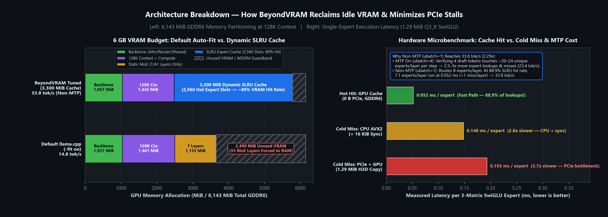

<h1 align="center">BeyondVRAM</h1>

<p align="center">
  <strong>VRAM Budgeting, Dynamic Expert Caching & Hardware Profiling for 19B MoE Inference on 6 GB GPUs</strong>
</p>

<p align="center">
  <a href="https://github.com/gauravpy3361#-how-i-build-ai-transparency">
    
  </a>
  
  
  <a href="LICENSE">
    
  </a>
</p>

Mixture-of-Experts (MoE) language models have large total parameter counts, but each token activates only a small fraction of experts (`Top-8` out of `128` per layer in `Groot-19B-A3B`). On a **6 GB laptop GPU**, the full `7.82 GiB` model (`Q3_K_S`) plus a `128K` context buffer cannot fit in VRAM, forcing expert weights into system RAM.

By default, `llama.cpp` (`-fit on`) offloads MoE layers **all-or-nothing** with a conservative `1 GiB` reserve—leaving **`2.49 GiB` of VRAM unused** and decoding at **`14.8 tok/s`**.

**BeyondVRAM** parses GGUF tensor geometry to reclaim that idle VRAM for a **Segmented-LRU (SLRU) expert cache** (`--moe-cache-mib 3300`) and tunes speculative batching (`MTP` vs. `Non-MTP`):
- **Skewed expert locality:** Caching just **`48.8%`** of experts (`2,560 / 5,248` slots in VRAM) serves **`~89%`** of all expert lookups directly from GDDR6 memory.
- **2.29x decode speedup:** Sustained generation increases from **`14.8 tok/s`** (Default `llama.cpp`) to **`23.4–24.0 tok/s`** (**`1.6x`**, MTP On) and **`33.8 tok/s`** (**`2.29x`**, Non-MTP) at `128K` context on an RTX 3050 6 GB laptop GPU.


---

## Benchmark Results

All controlled measurements run `Groot-19B-A3B-261023.i1-Q3_K_S.gguf` (`7.82 GiB`) with **`128K` context allocated** (`-c 131072 -fa on -ctk q4_0 -ctv q4_0`), greedy decoding (`--temp 0`), a `916`-token prompt, and `200` generated tokens. Raw per-run logs are stored in [`benchmarks/ablation_results.json`](benchmarks/ablation_results.json).

### 1. Default `llama.cpp` vs. BeyondVRAM Tuned (MTP & Non-MTP)

| Configuration | Speculative Mode | Decode (`tok/s`) | Speedup vs. Default | SLRU Hit Rate | VRAM Used |
| :--- | :--- | ---: | ---: | ---: | ---: |
| **Default `llama.cpp`** (`-fit on`) | MTP On (`draft-mtp`) | `14.8` | `1.00x` (Baseline) | — | `3,653 MiB` |
| **BeyondVRAM Tuned** (`--moe-cache-mib 3300`) | MTP On (`draft-mtp`) | `23.4` | **`1.58x` (`+58.2%`)** | `89.8%` | `5,779 MiB` |
| **BeyondVRAM Hybrid** (`Static + 1650 MiB Cache`) | MTP On (`draft-mtp`) | `24.0` | **`1.62x` (`+62.3%`)** | `75.4%` | `5,779 MiB` |
| **BeyondVRAM Tuned** (`--moe-cache-mib 3300`) | **Non-MTP (`--spec-type none`)** | **`33.8`** | **`2.29x` (`+128.6%`)** | **`88.9%`** | `5,573 MiB` |

#### Why Non-MTP (`--spec-type none`) is 44% faster than MTP On (`draft-mtp`)
`Groot-19B-A3B` includes a Multi-Token Prediction (`nextn`) head that drafts 4 tokens per verification step (`ubatch = 4`):
- **MTP On (`ubatch = 4`):** Verifying 4 candidate tokens in parallel activates **`~20–24` unique experts per layer** (`2.5–3x` more unique experts than a single token) while accepting `~1.4–1.8` tokens per step (`34.7%` acceptance). Because MoE cache misses scale with the number of unique experts touched per step, the wider micro-batch increases PCIe traffic.
- **Non-MTP (`ubatch = 1`):** Disabling speculative drafting routes exactly **`8` experts per layer**. At an **`88.9%`** SLRU cache hit rate, **`7.1` of `8` experts execute directly in VRAM** (`0.91` cache misses per layer), reaching **`33.8 tok/s`**.

### 2. Sustained Long-Generation Suite (`3 × 1,000` Tokens, MTP On)

Tested across three technical workloads (~`900`-token prompt → `1,000` generated tokens each, `3,000` generated tokens total). Raw telemetry is in [`benchmarks/results_3x1k.json`](benchmarks/results_3x1k.json) and [`benchmarks/results_3x1k_std.json`](benchmarks/results_3x1k_std.json).

| Workload | Default `llama.cpp` (`-fit on`) | BeyondVRAM Tuned (`3300 MiB`) | Decode Speedup | SLRU Hit Rate |
| :--- | ---: | ---: | ---: | ---: |
| **Q1: Distributed 3D Parallelism** | `14.1 tok/s` | `23.6 tok/s` | **`+67.4%`** | `87.8%` |
| **Q2: AgentOS Kernel Architecture** | `14.8 tok/s` | `24.8 tok/s` | **`+66.8%`** | `90.2%` |
| **Q3: Compiler IR & CUDA PTX** | `18.5 tok/s` | `22.4 tok/s` | **`+21.5%`** | `89.0%` |
| **Suite Mean (`3,000` Decode Tokens)** | **`15.8 tok/s`** | **`23.6 tok/s`** | **`+49.3%`** | **`89.0%`** |

Total wall-clock completion time across the three workloads dropped from **`267.0 s` to `205.9 s` (`-61.1 s`)**.

---

## Architecture & How It Works



### 1. GGUF Tensor Geometry (`Groot-19B-A3B`, `Q3_K_S`)
[`src/header_parser.py`](src/header_parser.py) inspects the GGUF binary header and classifies every tensor by role:
- **Always-active backbone (`1,037 MiB` on GPU):** Token embeddings, RMS norms, attention (`10` GQA layers), recurrent state-space layers (`31` SSM layers), router gates, and `1` shared expert per block.
- **128K Context + Compute buffers (`1,442 MiB` on GPU):** `720.0 MiB` quantized KV cache (`Q4_0`) + `251.5 MiB` recurrent SSM state + `471.0 MiB` compute graph scratchpad.
- **Routed MoE experts (`6,765 MiB` in Host RAM):** `41` MoE blocks × `128` experts = **`5,248` total experts**. Each quantized 3-matrix SwiGLU expert (`W_gate`, `W_up`, `W_down`) is **`1.289 MiB` (`1,351,680 B`)**.

### 2. Why Default Auto-Fit Leaves `2.49 GiB` Idle vs. Dynamic SLRU Caching
- **Default `llama.cpp` (`-fit on`):** Allocates MoE experts at whole-layer granularity (`165 MiB/layer`) and holds a `1,024 MiB` safety margin. Only `7` of `41` MoE layers fit in VRAM (`3,653 MiB` used); the remaining `35` layers execute on the CPU while `2,490 MiB` of VRAM sits empty.
- **BeyondVRAM Tuned (`--moe-cache-mib 3300`):** Reclaims the unused VRAM to allocate **`2,560` individual expert slots** (`3,300 MiB`, leaving a safe `364 MiB` WDDM guardband).
  - **Segmented-LRU (SLRU) replacement:** Newly fetched experts enter a **Probation** segment. A second hit promotes them to a **Protected** segment (capped at `50%` of cache slots), preventing one-off token activations from evicting frequently used experts.
  - **Prefill protection:** Large prompt batches (`n_tokens > 32`) do not evict decode slots, preserving the hot expert working set across turns.

See [`docs/ARCHITECTURE.md`](docs/ARCHITECTURE.md) for the full memory specification and runtime trace breakdown.

---

## Hardware Microbenchmarks (C++17 / CUDA)

To isolate the hardware mechanisms governing MoE offloading, this repository includes standalone CUDA/C++ microbenchmarks in [`src/`](src/):

### 1. Dual-Stream PCIe DMA / Compute Overlap ([`src/async_pipeline.cu`](src/async_pipeline.cu))
Streams a `1.29 MiB` cold expert over PCIe (`cudaMemcpyAsync` on `stream_dma`) concurrently with attention + hot-expert compute (`stream_compute`), synchronized via bidirectional `cudaEvent_t` barriers (`0.00e+00` numerical diff vs. sequential execution).
- **Single-stream sequential:** `0.464 ms / step`
- **Dual-stream pipelined:** **`0.287 ms / step` (`1.61x` speedup / `38.1%` latency reduction)**


### 2. Single-Expert Execution Latency ([`src/zero_transfer_ffn.cpp`](src/zero_transfer_ffn.cpp))
Benchmarks a full 3-matrix `Q3_K` SwiGLU expert (`[512 × 2048]` × 3, `1.29 MiB`), including `16 KiB` (`8 KiB` D2H + `8 KiB` H2D) activation transfers and stream synchronization on the CPU fallback path:

| Execution Path | Latency per Expert | Relative Speed | PCIe Traffic |
| :--- | ---: | ---: | ---: |
| **GPU SLRU Cache Hit (Resident in GDDR6)** | **`0.052 ms`** | **`3.68x` faster** | `0 B` |
| **Cold Miss: CPU AVX2 In-Place + Sync** | `0.148 ms` | `1.30x` faster | `16 KiB` (Activations) |
| **Cold Miss: PCIe Upload + GPU SwiGLU** | `0.193 ms` | `1.00x` (Baseline) | `1.29 MiB` (Weights) |

---

## Quick Start

### 1. Auto-Tuned Launch via `beyondvram.py`
`beyondvram.py` detects your GPU's VRAM capacity, parses the GGUF model header, computes the optimal `--moe-cache-mib` budget, and launches `llama-cli`:

```powershell
git clone https://github.com/gauravpy3361/BeyondVRAM.git
cd BeyondVRAM

# Preview VRAM budget & optimal command (--dry-run)
python beyondvram.py --model "C:\path\to\Groot-19B-A3B-Q3_K_S.gguf" --mode non-mtp --dry-run

# Launch in Peak Non-MTP mode (33.8 tok/s on RTX 3050 6 GB)
python beyondvram.py --model "C:\path\to\Groot-19B-A3B-Q3_K_S.gguf" --mode non-mtp

# Launch in MTP mode (23.4 tok/s)
python beyondvram.py --model "C:\path\to\Groot-19B-A3B-Q3_K_S.gguf" --mode mtp
```

### 2. Direct `llama-cli` Commands
```powershell
# 1. Calculate the exact cache budget for your GPU & context window
python src/header_parser.py --model "C:\path\to\model.gguf" --vram 6143 --ctx 131072

# 2A. BeyondVRAM Tuned — Non-MTP (Peak Decode: 33.8 tok/s)
llama-cli.exe -m "C:\path\to\model.gguf" -c 131072 -fa on -ctk q4_0 -ctv q4_0 -cmoe --moe-cache-mib 3300 --spec-type none

# 2B. BeyondVRAM Tuned — MTP On (23.4 tok/s)
llama-cli.exe -m "C:\path\to\model.gguf" -c 131072 -fa on -ctk q4_0 -ctv q4_0 -cmoe --moe-cache-mib 3300 --spec-type draft-mtp
```

---

## Reproducing Benchmarks & Microbenchmarks

### End-to-End `llama.cpp` Benchmarks & Charts
```powershell
$env:LLAMA_CLI_PATH = "C:\path\to\llama-cli.exe"
$env:BEYONDVRAM_MODEL = "C:\path\to\Groot-19B-A3B-261023.i1-Q3_K_S.gguf"

python src/run_controlled_ablation.py     # Writes benchmarks/ablation_results.json
python src/run_full_3x1k_std_bench.py     # Long-generation suite (Default llama.cpp)
python src/run_full_3x1k_bench.py         # Long-generation suite (BeyondVRAM Tuned)
python src/plot_benchmarks.py             # Generates docs/assets/benchmark_results.png & vram_and_locality.png
```

### C++17 / CUDA Microbenchmarks
Run inside an **x64 Native Tools Command Prompt for VS 2022** with CUDA Toolkit installed (`sm_86` = RTX 3050 Ampere):
```powershell
cl /EHsc /O2 /std:c++17 /I src tests\test_cache.cpp src\beyond_vram_cache.cpp /Fe:bin\test_cache.exe
nvcc -O3 -arch=sm_86 src\async_pipeline.cu -o bin\async_pipeline.exe
nvcc -O3 -x cu -arch=sm_86 -Xcompiler "/O2 /openmp /arch:AVX2" src\zero_transfer_ffn.cpp -o bin\bench_zero_transfer.exe

.\bin\test_cache.exe
.\bin\async_pipeline.exe
.\bin\bench_zero_transfer.exe
```

---

## Repository Structure

```text
BeyondVRAM/
├── beyondvram.py                    # Auto-tuning CLI launcher & VRAM budgeter
├── README.md
├── LICENSE
├── docs/
│   ├── ARCHITECTURE.md              # Full memory hierarchy & runtime specification
│   └── assets/                      # Generated benchmark & hardware trace plots
├── benchmarks/
│   ├── ablation_results.json        # Controlled Default vs. BeyondVRAM (MTP & Non-MTP) telemetry
│   ├── results_3x1k*.json           # 3x (1K Prompt x 1K Decode) long-generation telemetry
│   ├── nsys_trace_summary.json      # Exported NVIDIA Nsight Systems CUPTI timestamps
│   └── prompts/                     # Technical benchmark prompts
├── src/
│   ├── header_parser.py             # GGUF tensor geometry parser & VRAM budget calculator
│   ├── run_controlled_ablation.py   # Deterministic benchmark harness (--temp 0)
│   ├── run_full_3x1k_*.py           # Long-generation suite runners
│   ├── plot_benchmarks.py           # Renders benchmark_results.png & vram_and_locality.png
│   ├── plot_nsys_timeline.py        # Renders nsys_timeline.png from CUPTI SQLite trace
│   ├── async_pipeline.cu            # CUDA dual-stream DMA/compute overlap microbenchmark
│   ├── zero_transfer_ffn.cpp        # 3-matrix SwiGLU GPU hit vs. CPU AVX2 vs. PCIe microbenchmark
│   ├── beyond_vram_cache.{h,cpp}    # Standalone C++17 SLRU cache reference implementation
│   └── benchmark_comparator.py      # Analytical PCIe traffic & latency calculator
└── tests/
    └── test_cache.cpp               # Unit tests for C++17 SLRU cache eviction & promotion
```

---

## Hardware & Software Environment

| Component | Specification |
| :--- | :--- |
| **GPU** | NVIDIA GeForce RTX 3050 6 GB Laptop GPU (`6,143 MiB` GDDR6, Compute `8.6`, PCIe 4.0) |
| **CPU** | Intel Core 5 210H (`12` threads, AVX2 + FMA) |
| **System RAM** | `16 GB` DDR4-3200 (Single-Channel) |
| **Software** | Windows 11, `llama.cpp` (`b1-ac8e169`), CUDA `13.2`, MSVC `19.44`, Nsight Systems `2025.6.3` |
| **Model** | `Groot-19B-A3B-261023.i1-Q3_K_S.gguf` (`7.82 GiB`, `41` MoE blocks × `128` experts, `Top-8`) |

### Scope & Experimental Notes
- **Upstream runtime integration:** End-to-end inference uses upstream [`llama.cpp`](https://github.com/ggml-org/llama.cpp)'s `--moe-cache-mib` SLRU cache; this repository provides the GGUF VRAM budgeter (`src/header_parser.py`), auto-tuning launcher (`beyondvram.py`), benchmark suite, and standalone C++/CUDA hardware microbenchmarks.
- **Prefill vs. decode trade-off:** Prompt prefill (`pp`) runs at `~217–257 tok/s` with `--cpu-moe` because large batches bypass cache eviction so long prompts never flush the decode working set.
- **Hardware sensitivity:** Measurements reflect a mobile RTX 3050 (`6 GB`) paired with single-channel DDR4 RAM. Systems with dual-channel DDR5 or wider PCIe buses will see higher baseline CPU throughput and faster PCIe transfers.

---

## Related Work

MoE offloading and expert caching build on principles explored in [Mixtral-Offloading](https://arxiv.org/abs/2312.17238) (LRU caching and speculative expert prefetching), [Fiddler](https://arxiv.org/abs/2402.07033) (CPU-assisted expert execution), [MoE-Infinity](https://arxiv.org/abs/2401.14361), and [KTransformers](https://github.com/kvcache-ai/ktransformers). BeyondVRAM evaluates how Segmented-LRU caching and speculative micro-batching (`MTP` vs. `Non-MTP`) interact inside `llama.cpp` under strict 6 GB consumer laptop constraints.

## License

Licensed under the [Apache License 2.0](LICENSE).
